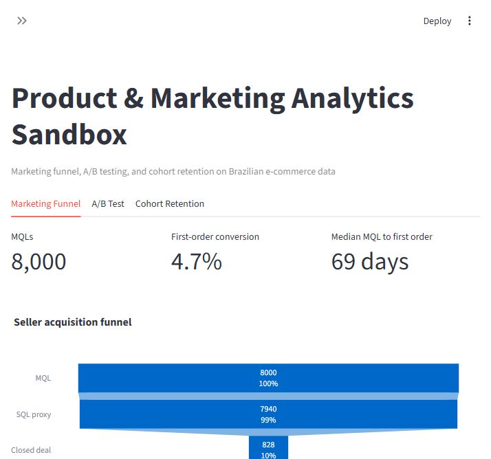
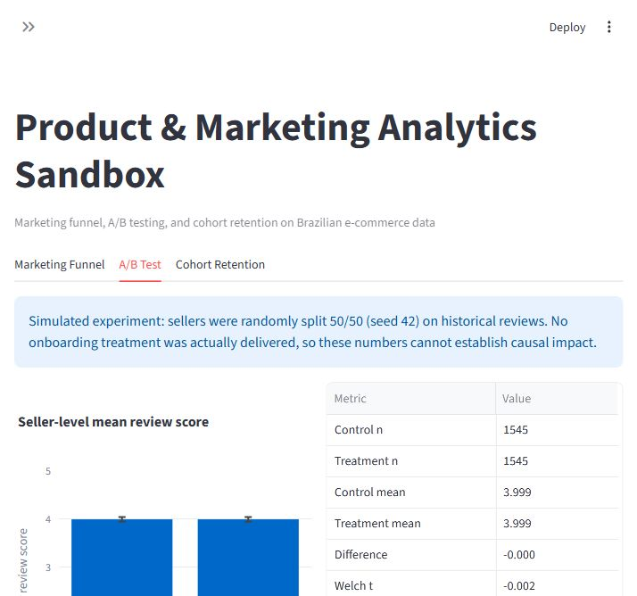
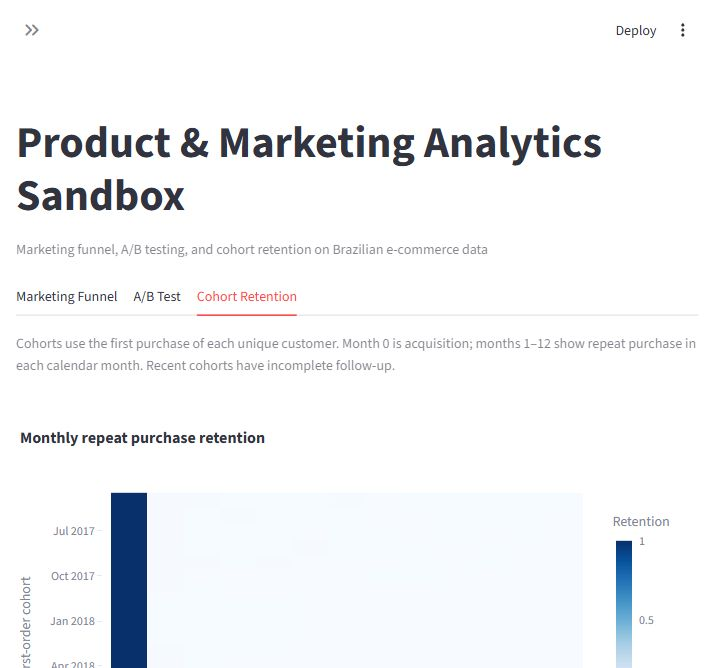

# Product & Marketing Analytics Sandbox

An interactive portfolio dashboard that turns public Brazilian e-commerce data into a seller acquisition funnel, a transparent simulated experiment, and customer retention cohorts.

[Live demo on Streamlit Cloud — coming soon](#)

## Dashboard preview

| Marketing funnel | Simulated A/B test | Cohort retention |
|---|---|---|
|  |  |  |

## What it does

- **Marketing funnel:** traces 8,000 marketing qualified leads through an explicit SQL *proxy*, closed deals, and sellers' first orders; shows conversion and segment breakdown.
- **A/B analysis:** randomly assigns sellers to illustrative treatment and control groups, then compares historical mean review scores with Welch's t-test, confidence interval, Cohen's d, and power. No treatment was actually delivered, so this is a statistical demonstration rather than a causal estimate.
- **Cohort retention:** groups unique customers by first-order month and tracks repeat purchasing and payment revenue for up to 12 months. Future months without observation are blank.

## Key findings

- The observed funnel has **8,000 MQLs → 7,940 SQL-proxy leads → 828 closed deals → 376 first orders**, or **4.7%** end-to-end conversion. The SQL proxy means lead origin and landing page are both recorded; Olist has no actual SQL event table.
- Seller-level review scores were **3.99887 control vs 3.99882 simulated treatment**. Welch p = **0.9988** and Cohen's d ≈ **−0.00005**: no significant or practically meaningful difference. Observed-effect power is about **5%** and should not be used as evidence for the null.
- The **November 2017** customer cohort generated the highest observed payment revenue, about **BRL 1.20 million**. Repeat purchase rates are low; interpret recent cohorts with their shorter follow-up in mind.

## Tech stack

Python 3.11 · Streamlit · pandas · Plotly · SciPy · statsmodels · Parquet

## Run locally

```powershell
uv venv .venv --python 3.11
uv pip install --python .venv\Scripts\python.exe --no-cache -r requirements.txt
.venv\Scripts\streamlit.exe run app.py
```

The checked-in `data/processed/*.parquet` files make the app runnable without downloading raw data. To rebuild them, download the CSVs listed in `src/data_load.py` into `data/raw/`, then run `.venv\Scripts\python.exe -m src.data_load`.

## Data source and limits

Public [Olist Brazilian E-Commerce](https://www.kaggle.com/datasets/olistbr/brazilian-ecommerce) and [Olist Marketing Funnel](https://www.kaggle.com/datasets/olistbr/marketing-funnel-olist) datasets, retrieved as individual CSVs from [commerce mirror](https://github.com/Aditya-Prasad1107/olist_dataset_csv) and [marketing mirror](https://github.com/Saniya1312S/Olist-Marketing-Funnel-Lead-Conversion). Seller acquisition and customer retention are distinct populations. Review data is observational. The dashboard's experiment assignment is simulated and does not imply a real onboarding intervention.

Built as a portfolio project by **Mahmoud Magdy**.
